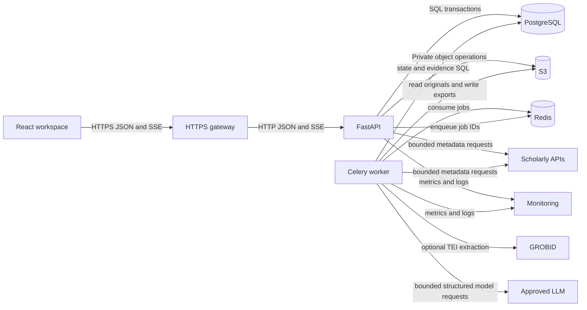
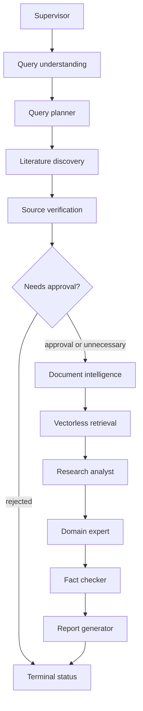
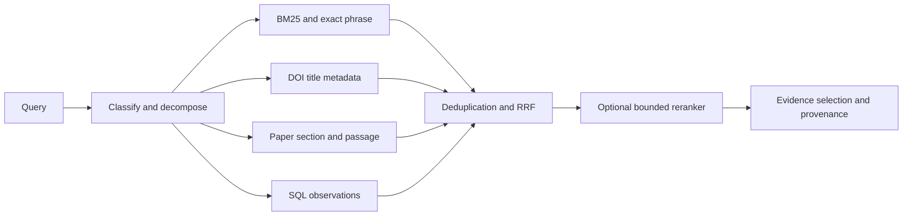
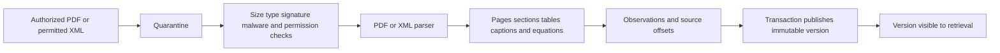

# ResearchPilot AI architecture

## Product and release gates

Researchers organize work in tenant-scoped projects, discover scholarly metadata, ingest permitted documents, interrogate the evidence, compare scientific observations, and export traceable reports. The first evaluation domain is energy and chemical engineering. Methods and data structures are domain-neutral. Unsupported claims are withheld, missing evidence is reported, and abstract-only evidence remains labeled.

| Milestone | Exit gate |
| --- | --- |
| 0 Requirements and architecture | Architecture, directory map, ERD, API contract and threat model reviewed |
| 1 Workspace | Register, authenticate, create projects and persist conversations |
| 2 Discovery | Find scholarly records and independently resolve DOI metadata |
| 3 Ingestion | Upload a permitted paper, parse it asynchronously and inspect immutable passages |
| 4 Retrieval | Exercise all six query strategies and measure held-out evidence retrieval |
| 5 Research | Resume a bounded LangGraph workflow and inspect claim-level citations |
| 6 Comparison and reports | Compare compatible observations and export a cited report |
| 7 Evaluation and hardening | Run authorization, failure, evidence, latency and cost checks |
| 8 Deployment | Repeatable HTTPS deployment and tested restore and rollback |

## Component and deployment topology



React owns presentation, navigation and transient form state. A typed HTTP client forwards the session cookie, aborts stale requests and reconciles run events with durable status. An evidence inspector resolves stored evidence IDs and displays the verbatim text and location. Components render untrusted content as text. FastAPI validates input and permissions before calling application services. SQLAlchemy owns persistence and Alembic owns schema changes. The API returns job IDs after enqueuing ingestion, research and report jobs. Redis carries identifiers and delivery metadata. Database state is authoritative. Workers recheck ownership and build outputs from immutable document versions. The deployment uses an HTTPS gateway, API, worker, Redis and managed PostgreSQL and object storage. An optional parser lives on a private network. See [operations](deployment.md).

## Sequence and boundaries

| Operation | Execution and service communication |
| --- | --- |
| Workspace writes and evidence lookups | Synchronous HTTP → permission check → parameterized SQL → typed response |
| Scholarly search and DOI lookup | Synchronous bounded HTTPS to configured scholarly APIs → normalize, cache and persist provenance → response |
| Upload and parse | Synchronous authenticated upload → quarantine object and durable job record → enqueue → asynchronous parser → atomic index publication |
| Retrieval | Synchronous SQL, metadata and lexical retrieval over authorized versions. Optional reranking uses a bounded provider call in a research worker |
| Research | Background LangGraph supervisor delegates by typed state, checkpoints each node and records a timeline. UI reads run status and streams durable events |
| Reports | Background assembly of verified claims, bibliographic resolution and artifact write. Export downloads require project authorization |
| Approval | Synchronous authorization and decision write → async resumption from checkpoint. Rejections terminate the run |

Queue delivery is at least once. Each published output uses its stable job or version ID as the idempotency key. Long-running jobs use bounded retries, terminal states and explicit partial results. A production outbox or reconciliation loop must recover database-to-queue handoff failures.

## Agents



Agents communicate through typed state owned by the supervisor. State carries the authorized project, planned queries, evidence IDs, structured claims, decision status and budgets. Model responses may propose structured outputs. Trusted code controls routing, resolves citations and authorizes tools. Provider timeouts and retries consume a shared budget. Checkpoints bind to the project and run. Human approval is required for approved sensitive operations such as release to an external model. Document text cannot authorize tool calls or change routing.

| Module | Inputs → outputs | Dependencies and failure handling |
| --- | --- | --- |
| Supervisor | Run and checkpoint → routed workflow and terminal status | LangGraph, queue and persistence. Exhausted budgets terminate safely |
| Query understanding | User question → intent, domain and constraints | Classifier. Ambiguity falls back to lexical search |
| Planner | Classified question → bounded subqueries | Query router. Invalid plans fall back to the original query |
| Discovery | Subqueries → scholarly candidates | Official connector APIs. Partial provider failures preserve available results |
| Verification | Candidate identifiers and metadata → source status and provenance | DOI resolvers. Conflicts and unavailable metadata remain visible |
| Document intelligence | Authorized versions → searchable structure | Object storage and parsers. Failed or inaccessible content remains unavailable |
| Retrieval | Plans and filters → ranked evidence | BM25, database and optional model. Model failures preserve local ranks |
| Analyst | Evidence and observations → findings and comparison candidates | Provenance and comparison policies. Sparse contexts yield explicit gaps |
| Domain expert | Findings and conditions → bounded interpretation | Domain policies and approved deterministic calculations. Incompatible conditions block numerical comparisons |
| Fact checker | Claims and cited passage IDs → accepted claims and gaps | Stored passages, source status and comparison checks. Missing or unsupported citations fail closed |
| Report generator | Checked claims → report and references | Rendering and export. Failed artifacts are retryable independently |

## Vectorless retrieval



| Intent | Retrieval plan |
| --- | --- |
| Specific paper | Exact DOI, exact title, bibliographic filters, then lexical confirmation |
| Definition | Scientific keyword and exact terminology, prioritize definitional passages |
| Numerical result | Parameterized SQL over vetted observations and lexical retrieval over tables and captions |
| Experiment comparison | Parallel subqueries and per-paper coverage, followed by context and unit checks |
| Literature review | Paper and section routing, then diverse passage selection |
| Technical recommendation | Decompose constraints, retrieve across independent sources and return evidence gaps |

PostgreSQL textual indexes can narrow candidates at scale. BM25 is computed from corpus statistics and multiple ranks use reciprocal rank fusion. Structural retrieval rolls results up to their sections and returns passages by stable ID. Evidence preserves version, page, section, table or figure, passage text, DOI and access kind. Retriever and reranker protocols allow experimental baselines. Evaluation configurations hold corpus, queries, labels and ranking cutoff constant. Generation and retrieval are measured separately.

## Ingestion



The original file has a checksum and tenant-scoped object key. PyMuPDF extracts text and page anchors, with GROBID for TEI structure and optional OCR or Docling when configured. Workers impose size, page and time budgets. Low-confidence or missing structure remains explicit. Stable passage IDs are allocated at publication. Observations retain raw text, units, conditions, evidence type, extraction confidence and passage links. Metadata-only records can be discovered independently of ingestion.

## Application modules

| Module | Inputs → outputs | Dependencies and failure handling |
| --- | --- | --- |
| Frontend | User input and API response → workspace and evidence views | React, Router, API client. Show retryable errors and empty states |
| API and auth | HTTPS request → validated DTOs or error | FastAPI, authorization, rate limits and database. Reject unauthorized access before reading resources |
| Repositories | Authorized IDs and DTOs → stored records | SQLAlchemy. Unique constraints and transactions reject conflicting writes |
| Connectors | Query, DOI, cursor → source-scoped metadata | HTTP client and provider adapters. Backoff on rate limits and expose partial outages |
| Ingestion | Approved assets → document versions and observations | Parser and storage adapters. Quarantine malformed input and fail publication atomically |
| RAG | Intent and candidates → ranked evidence | Retrieval protocol, rank fusion and provenance. Return empty evidence on empty corpus |
| Analysis | Versioned evidence → comparisons and claims | Structured scientific records. Missing units and conditions block comparison |
| Workers | Job IDs → persistent progress and artifacts | Celery, DB, storage. Retry recoverable failures with a bounded budget |
| Evaluation | Frozen corpus and labels → measured retrieval and evidence scores | Deterministic runner. Record missing labels and preserve failed runs |
| Infrastructure | Configuration and images → deployed services | Compose, HTTPS gateway and managed services. Health gates and migration-aware rollback |

## Target monorepo

```text
frontend/
  src/{components,pages,features,hooks,services,stores,types}/
  src/features/{research,literature,papers,projects,reports}/
  package.json
backend/
  app/{api,core,database,models,schemas,services,repositories}/
  agents/
  rag/
  ingestion/
  connectors/
  evaluation/
  migrations/versions/
  tests/
infrastructure/
  docker/
  monitoring/
  deployment/
docs/
  architecture.md
  database.md
  api.md
  security.md
  deployment.md
.github/workflows/
docker-compose.yml
.env.example
README.md
CHANGELOG.md
LICENSE
```
