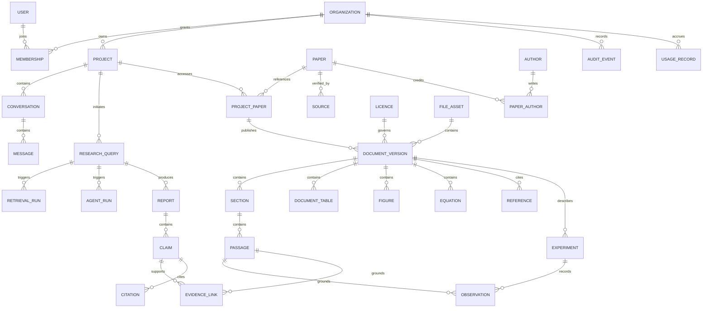

# Database architecture

Use UUID primary keys and foreign keys. Normalize DOI case and enforce uniqueness for non-null DOI. Preserve source-specific external IDs and fetched timestamps. Index tenant, project, version, job state and normalized metadata. Search indexes store derived text and can be rebuilt. Use relational columns for observation value, metric and unit, with JSONB for domain-specific conditions. Evidence links refer to immutable versions and passages. Every path to private content begins with the caller's project membership. Original assets live in private object storage. Define retention and backup policies for each deployment before onboarding confidential data.

## Current storage

Migrations include normalized authors and ordered paper credits, licence URLs, document versions, sections, passages, observations, and typed document artifacts. Tables, figures, equations and references share the artifact table with a type discriminator and retain a passage foreign key. Research, agent and report runs use typed job records and job events. Retrieval runs record routing, latency and result count. A claim's evidence links are its citations. The diagram describes the logical model. The executable schema is defined by the Alembic revisions.
